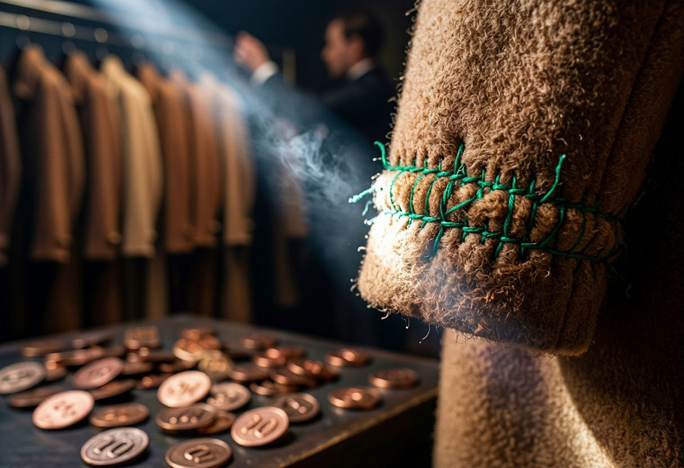
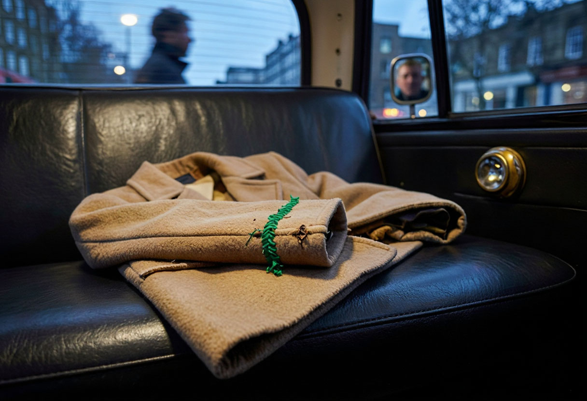
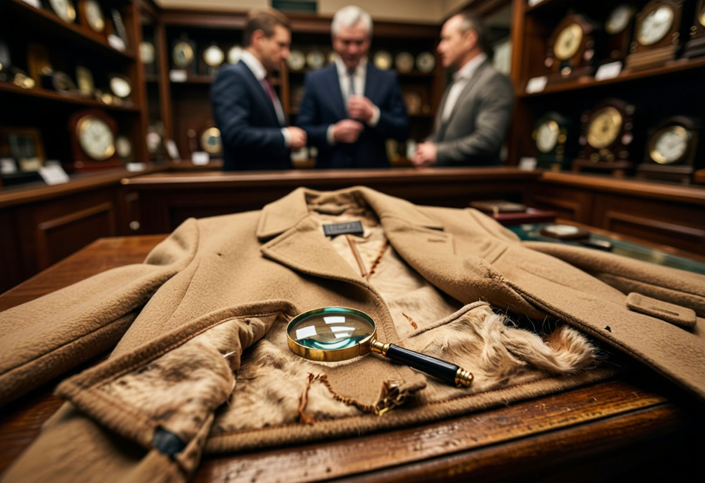
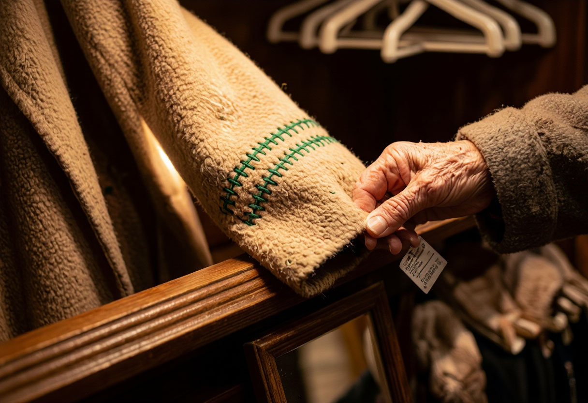
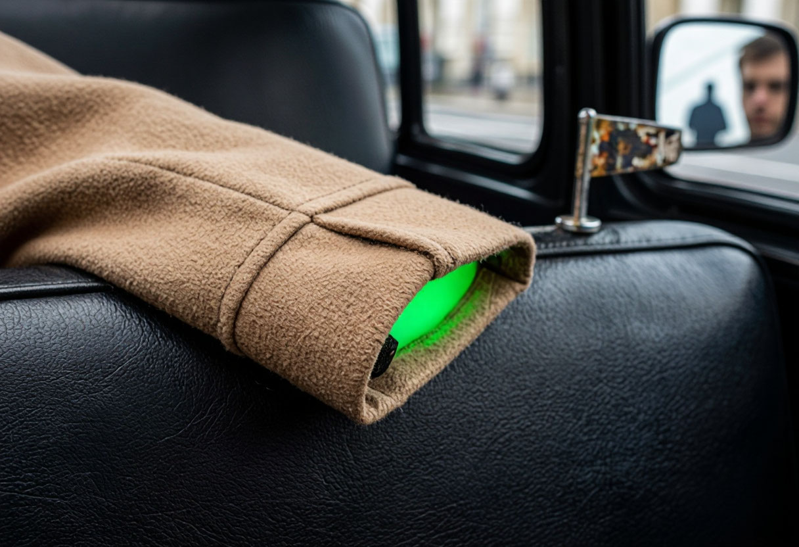
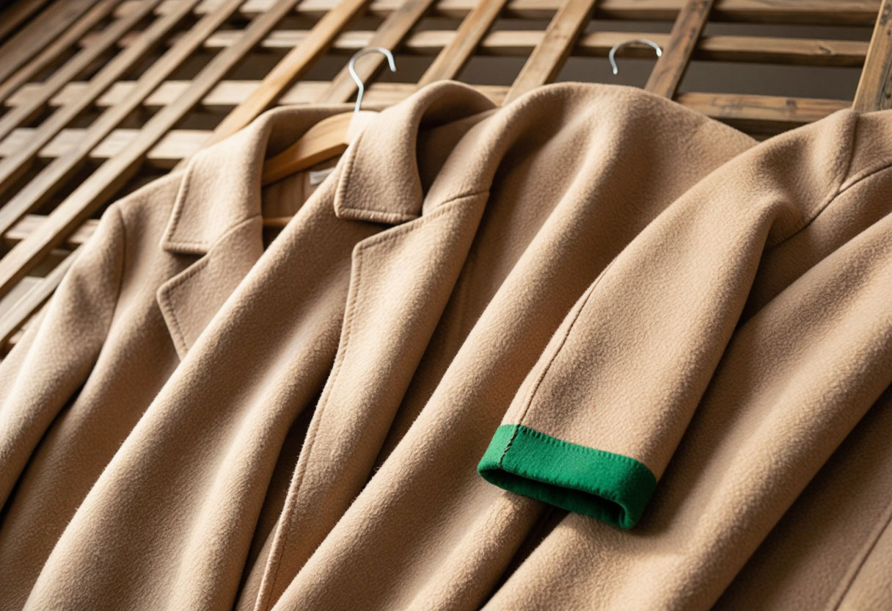

# Отчёт по лабораторной работе № 1 «Агент-художник»

## Выполнили

- **Крижановский Данил** — задал тематику и стиль серии, реализовал ноутбук, выбрал сюжет для промптов и провёл эксперименты.
- **Codex** — развернул краткие указания в промпты, помог с поиском ошибок и подготовил отчёт и галерею.

## Мотивирующий абзац (Project Statement)

В подкладке одного из четырёх похожих пальто спрятаны деньги. После поминок в лондонском клубе пальто перепутали. В серии «Пальто мистера Белла» зритель знает чуть больше героев: ещё в гардеробе он замечает несколько кривых зелёных стежков на бежевой манжете. По ним можно проследить путь пальто до чужих рук.

Две последние картины стоит посмотреть рядом. В ломбарде трое мужчин разглядывают подкладку через лупу, хотя на рукаве нет знакомой метки. В примерочной пожилая покупательница находит нужное пальто и замечает в нём недостаток.

## Использование ИИ

- DeepSeek и Qwen ведут диалог автора и художника. Итоговый промпт передаётся в Yandex ART.
- Qwen оценивает изображение по брифу. Художник уточняет промпт по замечаниям критика.
- Для сравнения генераторов использована Stable Diffusion 1.5. [Ноутбук с инструкциями](Agent_Artist.ipynb) · [Диалоги и результаты](results/коллекция.md)

## Результаты

В галерее доступны четыре картины, диалоги агентов и сравнение кадра до и после правки. [Открыть галерею](https://erstediy.github.io/PromptEngineering/lab1/)

| 1. Гардероб | 2. Заднее сиденье |
|---|---|
|  |  |
| Зелёная нить стягивает разрыв на манжете. Россыпь номерков подсказывает, как легко перепутать пальто. [Диалог агентов](results/01-cloakroom/20261115T152340234746Z/dialogue.md) | Пассажир ушёл, а знакомый рукав остался на кожаном сиденье кэба. [Диалог агентов](results/02-cab/20261115T153609790518Z/dialogue.md) |
| **3. Пустая подкладка** | **4. Скидка за штопку** |
|  |  |
| На прилавке лежит другое пальто. Через лупу мужчины видят пустую подкладку. [Диалог агентов](results/03-pawnshop/20261115T153741627377Z/dialogue.md) | В руке покупательницы рядом оказались потёртая манжета и ценник. [Диалог агентов](results/04-fitting-room/20261115T153836589732Z/dialogue.md) |

### Что изменила обратная связь

В первом кадре кэба нужные предметы уже были на месте. Однако внутри рукава светилось сплошное зелёное пятно. Критик попросил показать отдельные грубые стежки. После повторной генерации видны витки нитки, стягивающие края шерсти. Именно эта деталь связывает вторую картину с первой. [Промпты и оценки обеих версий](results/02-cab/20261115T153609790518Z/feedback-20261115T153612641751Z/сравнение.md)

| До замечания критика | После правки художника |
|---|---|
|  |  |

### Один промпт, два генератора

Обе модели получили русский текст «В ряд четыре бежевых пальто. Зелёная штопка на манжете одного». Он занял 69 из 77 токенов текстового энкодера Stable Diffusion. Yandex ART изобразил похожие бежевые пальто, но превратил штопку в ровную зелёную отделку. Открытая **Stable Diffusion 1.5** с Hugging Face при seed 42 изобразила заснеженную улицу. Промпт поместился целиком; причина расхождения в этом опыте не установлена. [Оба изображения, ревизия весов и параметры запуска](results/01-cloakroom/model-comparison/сравнение.md)

| Yandex ART | Stable Diffusion 1.5 |
|---|---|
|  |  |

## Выводы

Самый продуктивный вопрос художника касался постановки: куда смотрит зритель в тот момент, когда гардеробщик берёт пальто? Ответ дал сразу два решения для кадра — осветить нужную манжету и оставить движение руки в глубине. Так из короткого диалога получилась сцена, в которой зритель первым замечает ошибку.

Для визуальной проверки важна точность критерия. Условие «на рукаве есть зелёный цвет» выполнялось даже в неудачном кадре кэба. Условие «видна нить, которой заштопали разрыв» позволило исправить картину. При этом оценка критика нуждается в проверке человеком: в гардеробе модель засчитала четыре пальто, хотя на размытом заднем плане их трудно уверенно пересчитать.

Сравнение генераторов показало, что даже короткий промпт с конкретными деталями модели передают по-разному. Yandex ART изобразил ряд бежевых пальто, но превратил штопку в зелёную отделку. Stable Diffusion 1.5 при `seed=42` изобразила заснеженную улицу, хотя промпт поместился целиком. Для этой сцены Yandex ART оказался ближе к замыслу. Чтобы понять, насколько устойчив результат, стоило бы повторить опыт с другими значениями `seed`.
