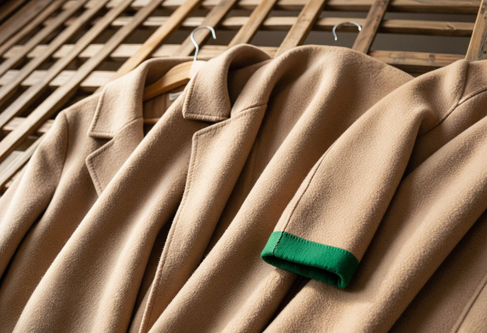

# «Гардероб». Один промпт, два генератора

Это два сравнительных варианта первой работы серии «Пальто мистера Белла». Для опыта взяли два признака сцены из диалога агентов. Зритель должен увидеть несколько похожих пальто и опознать одно из них по следам ремонта.

> В ряд четыре бежевых пальто. Зелёная штопка на манжете одного.

Обе модели получили один и тот же [русский промпт](prompt.txt). Токенизатор Stable Diffusion насчитал 69 токенов вместе со служебными при доступных 77. Весь текст поместился.

| Yandex ART | Stable Diffusion 1.5 |
|---|---|
|  |  |

В кадре Yandex ART похожие бежевые пальто висят рядом. Взгляд сразу находит единственную зелёную деталь на рукаве. Вблизи она выглядит как ровная полоса ткани по всему краю манжеты. Кривые стежки и повреждение шерсти не видны. Крупный план и перекрывающие друг друга силуэты также мешают уверенно насчитать четыре пальто.

Stable Diffusion 1.5 с выбранным seed изобразила заснеженную улицу с машинами и людьми. Ни ряд бежевых пальто, ни метку на рукаве различить нельзя. По этому прогону причина расхождения неизвестна.

Для сюжета Yandex ART точнее передал идею «одно пальто можно узнать среди похожих». Для коллекции в [кадре после замечания критика](../20261115T152340234746Z/feedback-20261115T152744906635Z/02.png) смысл улики читается лучше: зелёная нить стягивает разрыв в ткани.

## Параметры прогона

| Параметр | Yandex ART | Stable Diffusion 1.5 |
|---|---|---|
| Модель | `aliceai-image-art-3.0`, Images API | [stable-diffusion-v1-5/stable-diffusion-v1-5, использованная ревизия](https://huggingface.co/stable-diffusion-v1-5/stable-diffusion-v1-5/tree/451f4fe16113bff5a5d2269ed5ad43b0592e9a14) |
| Среда | Yandex AI Studio | Локальная RTX 4060, CUDA, веса FP16 |
| Параметры | Один кадр, запрос 1536 × 1024, seed не задавался | 768 × 512, seed 42, 25 шагов, guidance_scale 7.5, PNDMScheduler |
| Размер полученного PNG | 1216 × 832 | 768 × 512 |

Воспроизведение — раздел «Два генератора · один гардероб» в [ноутбуке](../../../Agent_Artist.ipynb).
