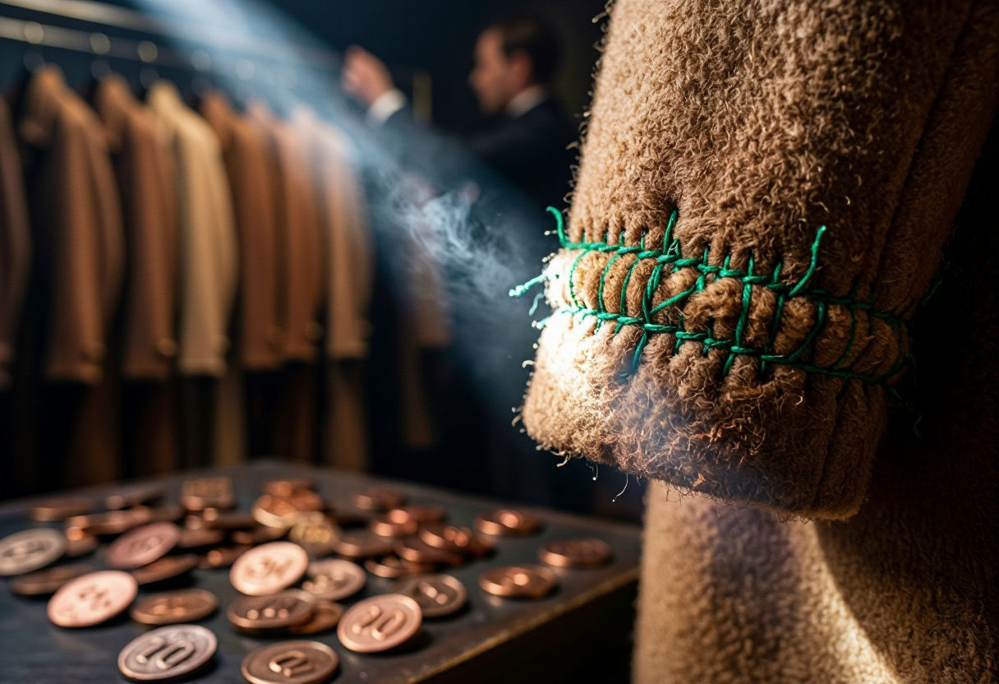
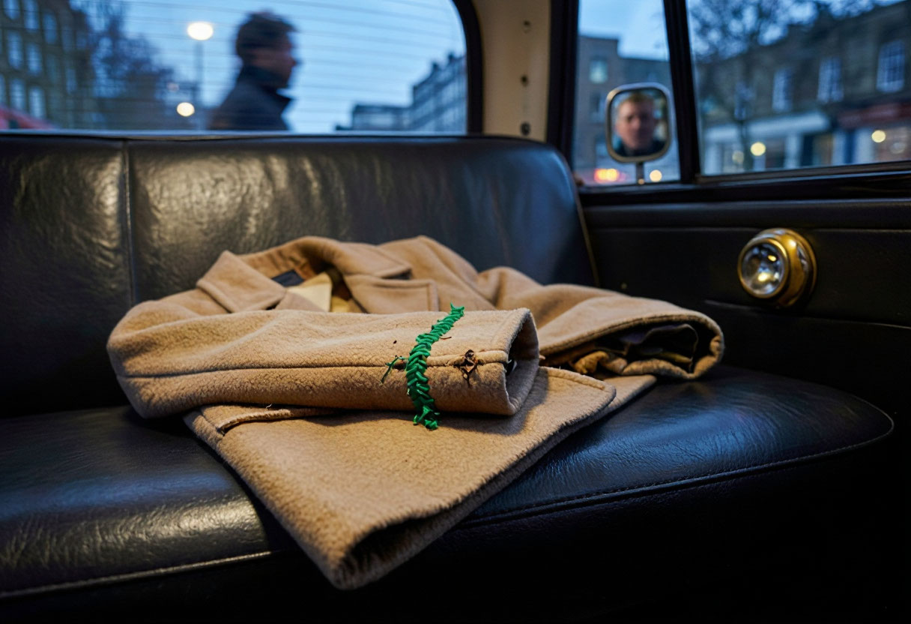
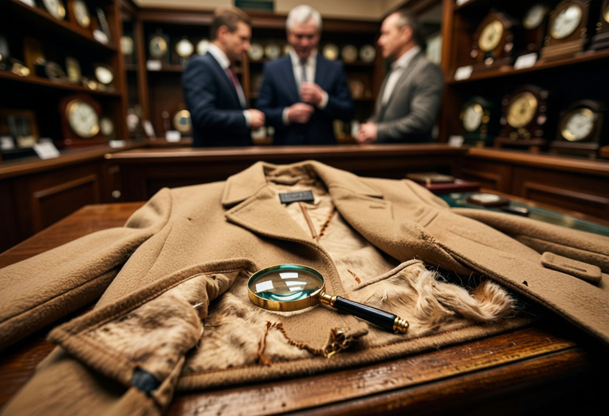
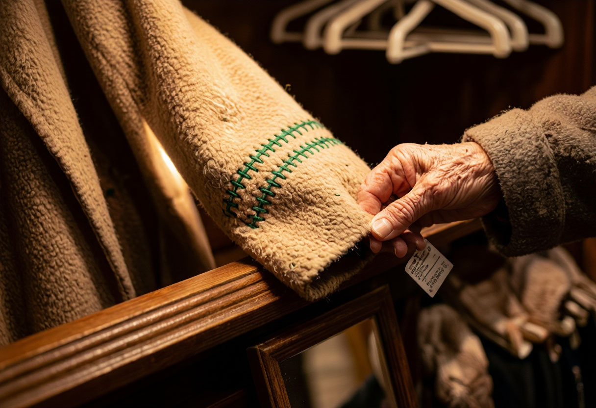

# Пальто мистера Белла

В подкладку одного из четырёх похожих пальто зашиты деньги. Узнать его можно по кривой зелёной штопке. После поминок в лондонском клубе пальто расходятся по городу.

## 1. Гардероб

После поминок гардеробщик тянется к соседнему пальто. Луч света открывает зрителю то, что легко пропустить в полутёмном клубе: зелёная нить грубо стягивает разрыв на бежевой манжете.

Из реплики автора: «ни один номер уже не помнит своего пальто»

[Бриф](01-cloakroom/20261115T152340234746Z/бриф.txt) · [Диалог](01-cloakroom/20261115T152340234746Z/dialogue.md) · [Промпт выбранного кадра](01-cloakroom/20261115T152340234746Z/feedback-20261115T152744906635Z/02-промпт.txt) · [Версии и критика](01-cloakroom/20261115T152340234746Z/feedback-20261115T152744906635Z/сравнение.md)

## 2. Заднее сиденье

Пассажир уже за окном. Рукав лежит поперёк кожаного сиденья, в зеркале осталось лицо водителя. По зелёной починке зритель узнаёт пальто из гардероба.

Из реплики автора: «Шофёр опускает флажок счётчика — щелчок, и от вибрации рукав пальто сползает на сантиметр по коже, будто пассажир наконец ответил.»

[Бриф](02-cab/20261115T153609790518Z/бриф.txt) · [Диалог](02-cab/20261115T153609790518Z/dialogue.md) · [Промпт выбранного кадра](02-cab/20261115T153609790518Z/feedback-20261115T153612641751Z/02-промпт.txt) · [Версии и критика](02-cab/20261115T153609790518Z/feedback-20261115T153612641751Z/сравнение.md)

## 3. Пустая подкладка

В ломбарде трое мужчин собрались у прилавка. Перед ними лупа и раскрытая подкладка. Они искали деньги; на пальто, которое им досталось, знакомой зелёной метки не видно.

Из реплики автора: «Пусть лупа ломбардщика медленно опустится в распоротую подкладку и замрёт, увеличивая пустоту»

[Бриф](03-pawnshop/20261115T153741627377Z/бриф.txt) · [Диалог](03-pawnshop/20261115T153741627377Z/dialogue.md) · [Промпт выбранного кадра](03-pawnshop/20261115T153741627377Z/feedback-20261115T153744195757Z/02-промпт.txt) · [Версии и критика](03-pawnshop/20261115T153741627377Z/feedback-20261115T153744195757Z/сравнение.md)

## 4. Скидка за штопку

Пожилая рука придерживает потёртый рукав рядом с магазинной биркой. Для покупательницы зелёные стежки — повод попросить скидку. Зритель уже знает, почему это пальто стоит дороже.

Из реплики автора: «большим пальцем она придерживает нитку, не давая ей спрятаться в шве»

[Бриф](04-fitting-room/20261115T153836589732Z/бриф.txt) · [Диалог](04-fitting-room/20261115T153836589732Z/dialogue.md) · [Промпт выбранного кадра](04-fitting-room/20261115T153836589732Z/feedback-20261115T153839253403Z/02-промпт.txt) · [Версии и критика](04-fitting-room/20261115T153836589732Z/feedback-20261115T153839253403Z/сравнение.md)

### Как читается серия

В гардеробе о путанице говорят неразобранные номерки, в кэбе — пальто на пустом сиденье. В ломбарде внимание переходит с манжеты на изнанку: зелёная штопка исчезает и возвращается лишь в примерочной. Обстановка первых трёх кадров различима по предметам. В последнем хорошо видны шов, руки и бирка; продавец остался за кадром, поэтому просьба о скидке читается как возможный смысл жеста. Рисунок самих стежков меняется между сценами. Связь поддерживают место починки, цвет нитки и бежевая шерсть.
